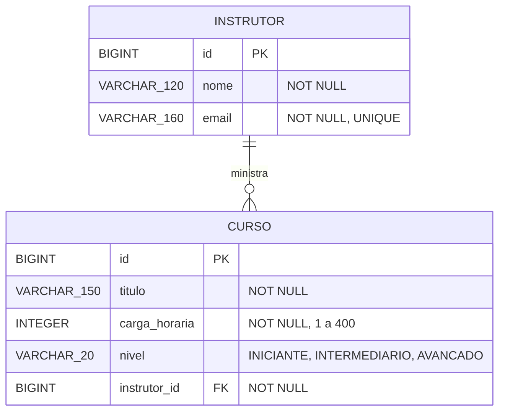

<h1 align="center">CATÁLOGO INDEPENDENTE DE CURSOS</h1>

<p align="center"><em>API REST de catálogo de cursos e instrutores desenvolvida no curso de Sistemas de Informação da <strong>UniFEF</strong>.</em></p>

<p align="center">
  
  
  
  
  
  
  
</p>

<br>

> **TL;DR**: API em Spring Boot que cadastra instrutores e cursos com relacionamento JPA 1:N bidirecional, schema versionado pelo Liquibase e validado pelo Hibernate, contrato REST com DTOs sem recursão e erros padronizados em `{ status, message, path }`. Atividade prática das Aulas 00 a 14 da disciplina Programação com Spring Boot.

<br>

## Índice

- [Sobre o projeto](#sobre-o-projeto)
- [Engenharia e padrões de projeto](#engenharia-e-padrões-de-projeto)
- [Modelo de dados](#modelo-de-dados)
- [Stack tecnológica](#stack-tecnológica)
- [Como executar](#como-executar)
- [Endpoints](#endpoints)
- [Testes automatizados](#testes-automatizados)
- [Coleção Postman](#coleção-postman)
- [Respostas do item 19](#respostas-do-item-19)
- [Autoria](#autoria)

<br>

## Sobre o projeto

O **Catálogo Independente de Cursos** organiza cursos livres e os instrutores responsáveis por eles. Cada instrutor pode ministrar vários cursos e cada curso pertence a exatamente um instrutor.

A API permite cadastrar instrutores, cadastrar cursos vinculados a um instrutor existente, consultar um curso com o resumo do seu instrutor e listar, em ordem alfabética, os cursos de um instrutor.

<br>

## Engenharia e padrões de projeto

- **Arquitetura em camadas**: `api` (controllers, DTOs, mappers e tratamento de erros), `application` (services e regras de negócio), `domain` (entidades) e `repository` (Spring Data JPA).
- **Relacionamento bidirecional consistente**: `Instrutor.adicionarCurso` é o único ponto de associação. Ele valida o curso, ajusta os dois lados da relação e evita duplicatas. A coleção é exposta só para leitura e não existe `setCursos` público.
- **Persistência versionada**: o Liquibase cria `instrutor`, depois `curso`, a chave estrangeira e a restrição única de email, todos os changesets com rollback. O Hibernate roda com `ddl-auto=validate`, sem gerar tabelas.
- **DTOs sem recursão**: a resposta de curso traz só o resumo `{ id, nome }` do instrutor e a listagem por instrutor não repete o instrutor, o que corta o ciclo curso → instrutor → cursos.
- **Transações explícitas**: escritas com `@Transactional` e consultas com `@Transactional(readOnly = true)`.
- **Erros centralizados**: um único `@RestControllerAdvice` converte validação em 400, recurso inexistente em 404 e email duplicado em 409, sem `try/catch` nos controllers.
- **Credenciais fora do código**: URL, usuário e senha do banco vêm de variáveis de ambiente.

<br>

## Modelo de dados



| Changeset | O que faz | Rollback |
| :--- | :--- | :--- |
| `001-criar-tabela-instrutor` | cria `instrutor` | `dropTable` |
| `002-criar-tabela-curso` | cria `curso` com `instrutor_id NOT NULL` | `dropTable` |
| `003-adicionar-fk-curso-instrutor` | FK `curso.instrutor_id → instrutor.id` e índice | `dropForeignKeyConstraint` e `dropIndex` |
| `004-adicionar-unique-email-instrutor` | `UNIQUE (email)` em `instrutor` | `dropUniqueConstraint` |

<br>

## Stack tecnológica

| Camada | Tecnologia |
| :--- | :--- |
| **Linguagem** | Java 21 (LTS) |
| **Framework Core** | Spring Boot 3.5.16 (Spring Web, Spring Data JPA, Bean Validation) |
| **Persistência / ORM** | Hibernate 6 / JPA 3.1 |
| **Banco de Dados** | PostgreSQL |
| **Migração de Schema** | Liquibase |
| **Build & Tooling** | Apache Maven (Maven Wrapper) |
| **Testes** | JUnit 5, Mockito, MockMvc, AssertJ, H2 em modo PostgreSQL |
| **Testes de API** | Postman / Newman |

<br>

## Como executar

### Pré-requisitos
- Java 21 (JDK 21+)
- PostgreSQL rodando na porta `5432`
- Git

### 1. Criar o banco de dados

Execute no `psql` ou no pgAdmin:

```sql
CREATE DATABASE catalogocursos_dev;
```

### 2. Configurar as variáveis de ambiente

Nenhuma senha fica no repositório. Informe as suas credenciais locais:

No Linux / macOS (Terminal):
```bash
export DB_URL=jdbc:postgresql://localhost:5432/catalogocursos_dev
export DB_USERNAME=seu_usuario
export DB_PASSWORD=sua_senha
```

No Windows (PowerShell):
```powershell
$env:DB_URL="jdbc:postgresql://localhost:5432/catalogocursos_dev"
$env:DB_USERNAME="seu_usuario"
$env:DB_PASSWORD="sua_senha"
```

### 3. Rodar a aplicação

No Linux / macOS:
```bash
./mvnw spring-boot:run
```

No Windows:
```powershell
.\mvnw.cmd spring-boot:run
```

Na primeira subida o Liquibase cria as tabelas. A API fica em `http://localhost:8080`.

### 4. Executar os testes automatizados

```bash
./mvnw clean test
```

Os testes não dependem do PostgreSQL local: rodam num H2 em memória em modo PostgreSQL, aplicando as mesmas migrações Liquibase e a mesma validação de schema.

<br>

## Endpoints

| Método | Endpoint | Responsabilidade | Sucesso |
| :--- | :--- | :--- | :--- |
| `POST` | `/api/instrutores` | cadastrar instrutor | `201 Created` + `Location` |
| `GET` | `/api/instrutores/{id}` | consultar instrutor | `200 OK` |
| `GET` | `/api/instrutores/{id}/cursos` | listar cursos do instrutor por título | `200 OK` |
| `POST` | `/api/cursos` | cadastrar curso | `201 Created` + `Location` |
| `GET` | `/api/cursos/{id}` | consultar curso | `200 OK` |

<details>
<summary><strong>Exemplos de requisição e resposta</strong></summary>

<br>

`POST /api/instrutores`
```json
{ "nome": "Marina Costa", "email": "marina.costa@example.com" }
```

`POST /api/cursos`
```json
{ "titulo": "APIs REST com Spring Boot", "cargaHoraria": 40, "nivel": "INTERMEDIARIO", "instrutorId": 1 }
```

`GET /api/cursos/10`
```json
{
  "id": 10,
  "titulo": "APIs REST com Spring Boot",
  "cargaHoraria": 40,
  "nivel": "INTERMEDIARIO",
  "instrutor": { "id": 1, "nome": "Marina Costa" }
}
```

`GET /api/instrutores/1/cursos`
```json
[
  { "id": 10, "titulo": "APIs REST com Spring Boot", "cargaHoraria": 40, "nivel": "INTERMEDIARIO" },
  { "id": 12, "titulo": "Java orientado a objetos", "cargaHoraria": 60, "nivel": "INICIANTE" }
]
```

`GET /api/instrutores/999/cursos`
```json
{ "status": 404, "message": "Instrutor não encontrado", "path": "/api/instrutores/999/cursos" }
```

</details>

| Situação | Status |
| :--- | :--- |
| dados de entrada inválidos | `400 Bad Request` |
| instrutor ou curso inexistente | `404 Not Found` |
| email já cadastrado | `409 Conflict` |

<br>

## Testes automatizados

36 testes em quatro camadas. Os quatro obrigatórios estão marcados com ✅.

| Classe | Camada | O que garante |
| :--- | :--- | :--- |
| `InstrutorTest` | domínio | ✅ `adicionarCurso` mantém os dois lados consistentes, sem duplicatas; coleção inicializada e só leitura; curso nulo rejeitado |
| `CursoRepositoryTest` | persistência | ✅ listagem traz só os cursos do instrutor, em ordem de título; busca de email existente |
| `EsquemaBancoTest` | persistência | `instrutor_id` obrigatório, chave estrangeira ativa e email único no banco |
| `CursoServiceTest` | service (Mockito) | ✅ curso com instrutor inexistente é rejeitado; associação dos dois lados ao cadastrar; curso inexistente |
| `InstrutorServiceTest` | service (Mockito) | email duplicado rejeitado sem salvar; instrutor inexistente na busca e na listagem |
| `InstrutorControllerTest` | API (MockMvc) | ✅ instrutor inválido retorna 400; 409 para email duplicado; 404 no formato `{ status, message, path }` |
| `CursoControllerTest` | API (MockMvc) | 400 para carga horária fora de 1 a 400, campos ausentes e nível inexistente; 404 para instrutor e curso inexistentes |
| `CatalogoApiTest` | API (MockMvc) | 201 com `Location`, consultas 200 e JSON sem recursão |

<br>

## Coleção Postman

Os arquivos ficam em [`postman/`](postman/):

- [`catalogocursos.postman_collection.json`](postman/catalogocursos.postman_collection.json): 17 requisições em 3 pastas (Instrutores, Cursos, Listagem por instrutor), com asserções de status, `Location`, formato dos DTOs e formato dos erros.
- [`catalogocursos.postman_environment.json`](postman/catalogocursos.postman_environment.json): variável `baseUrl` apontando para `http://localhost:8080`.

Importe os dois no Postman e rode a coleção inteira, na ordem, pelo Collection Runner. Cada execução gera um email novo, então a coleção pode rodar várias vezes seguidas. Pelo terminal:

```bash
npx newman run postman/catalogocursos.postman_collection.json -e postman/catalogocursos.postman_environment.json
```

<br>

## Respostas do item 19

**Qual entidade é proprietária da relação?**
`Curso`. É o lado `@ManyToOne` que guarda a chave estrangeira `instrutor_id`. Em `Instrutor`, a coleção `cursos` usa `mappedBy = "instrutor"`, ou seja, é só o lado inverso.

**Em qual tabela está a chave estrangeira?**
Na tabela `curso`, coluna `instrutor_id` (`NOT NULL`, referencia `instrutor.id`).

**Por que as entidades não foram retornadas diretamente pela API?**
Para desacoplar o contrato HTTP do modelo do banco, evitar a recursão infinita no JSON (curso → instrutor → cursos → instrutor → ...) e evitar `LazyInitializationException` ao serializar a coleção `LAZY` fora da transação. Os DTOs expõem só o que o cliente precisa, como o resumo `{ id, nome }` do instrutor.

**Banco utilizado:** `catalogocursos_dev` (PostgreSQL).

<br>

## Autoria

Desenvolvido em grupo por:

- **Murilo Rocha Silva** ([@murilolol](https://github.com/murilolol))
- **Adrienne Laysnara Xavier de Carvalho** ([@adrienne09](https://github.com/adrienne09))
- **Giovani Nunes Marques Luiz** ([@giovaninunes0701-commits](https://github.com/giovaninunes0701-commits))
